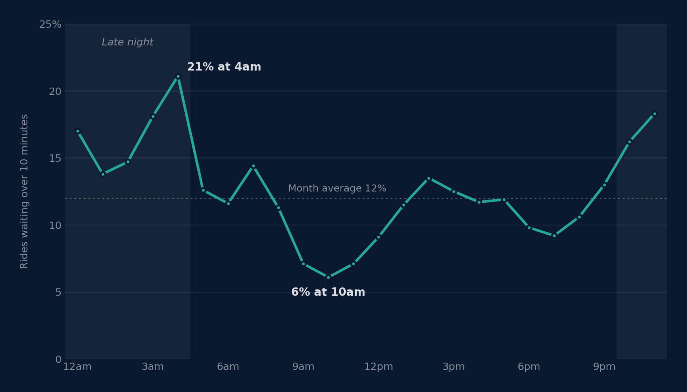

# Where New York's ride-hail riders wait too long

**Python · SQL (DuckDB) · 20.5 million trips · NYC Taxi and Limousine Commission, June 2026**

A marketplace team has a fixed driver-incentive budget. Where, and when, should it go to cut
long waits? The team is a scenario; the data is every Uber and Lyft trip in New York City for
a month.



## The answer

**Concentrate it, and pay drivers to be there rather than per ride.**

| | |
| --- | --- |
| **12%** | of rides wait more than 10 minutes: 2.5 million in the month |
| **92%** | of a long wait is the driver still on the way, not rider and driver finding each other |
| **44%** | of long waits fall in 10% of the city's zone-hours |

## Findings

1. **It is not a borough problem.** No borough owns it: Brooklyn holds 28% of long waits,
   Manhattan 28%, Queens 26%, the Bronx 16%. *So what:* a borough-wide scheme would
   spend most of its money where waits are already fine.
2. **It is a time-of-day problem.** 21% of rides wait long at 4am against 6% at 10am. Late night
   is 21% of rides and 30% of long waits; weekday-evening pickups at JFK and LaGuardia wait long
   39% of the time. *So what:* the problem has a schedule, and a budget can follow it.
3. **It is a supply problem, including at the airports.** Of a long wait, 12.9 minutes is the
   driver on the way and 1.2 at the curb. At the airports, where curb chaos was the expected
   cause, it is still 90% driver. *So what:* better pickup signage will not fix it; drivers in
   the right place will.
4. **Drivers are not paid less there.** Pay per trip-hour is $65.4 in the worst zone-hours
   against $63.7 elsewhere. *So what:* raising per-ride pay pays for rides that would happen
   anyway. Pay for availability instead.
5. **It is concentrated enough to target.** The worst 1,235 of 12,356 zone-hours hold 43.7% of
   long waits and 30% of rides. The result holds at 8 or 12 minutes (41 to 46%, 93% the same
   zone-hours). *So what:* a fixed budget can reach close to half the problem.

## Recommendation

| Action | Why | Impact | Effort |
| --- | --- | --- | --- |
| Concentrate the budget on the top tenth of zone-hours | 44% of long waits in 10% of the places and times | High | Low |
| Pay a guaranteed hourly minimum for drivers online in a target zone-hour, not a per-ride bonus | 92% of the wait is supply; pay is not lower there | High | Medium |
| Test it for four weeks on a random half of the target zone-hours before scaling | Nothing in this data measures an incentive's effect | Makes the rest defensible | Medium |

**Measured by** the share of rides over 10 minutes in the target zone-hours, the median time for
a driver to arrive, and the cost of each long wait avoided.

## Limits

- One month. Seasonality, holidays and weather are not covered.
- Completed trips only. Riders who gave up are missing, so the worst waits are undercounted.
- Uber and Lyft are combined. They differ sharply (13.6% against 7.7% long waits), possibly in
  how each records the request time; this is a market view, not one operator's.
- No incentive exists in the data, so its effect is estimated by the test, not here.
- Pay per trip-hour excludes time driving to a pickup or waiting for one.
- Taxi zones are coarse; a real scheme would target finer areas.

## How to run it

```bash
pip install -r requirements.txt
python fetch_data.py       # downloads June 2026, about 400MB
python run_analysis.py     # runs sql/01 to 06, writes outputs/
python validate.py         # 51 checks, including every figure above
python charts.py           # redraws charts/
python make_notebook.py    # rebuilds and runs analysis.ipynb
```

`outputs/` and `charts/` are committed, so the notebook and this page read without the download.

## What is here

| | |
| --- | --- |
| [`analysis.ipynb`](analysis.ipynb) | The argument, step by step, with every table |
| [`sql/`](sql) | One file per question: clean, how long, when and where, why, concentration, sensitivity |
| [`validate.py`](validate.py) | Integrity checks, an independent recount from the raw file, and every quoted figure |
| [`CLEANING_LOG.md`](CLEANING_LOG.md) | Every row removed, and why |
| [`DATA_DICTIONARY.md`](DATA_DICTIONARY.md) | Columns, derived fields and terms |

Data: [NYC TLC Trip Record Data](https://www.nyc.gov/site/tlc/about/tlc-trip-record-data.page),
High Volume For-Hire Vehicle records.

By Chris Awoke.
